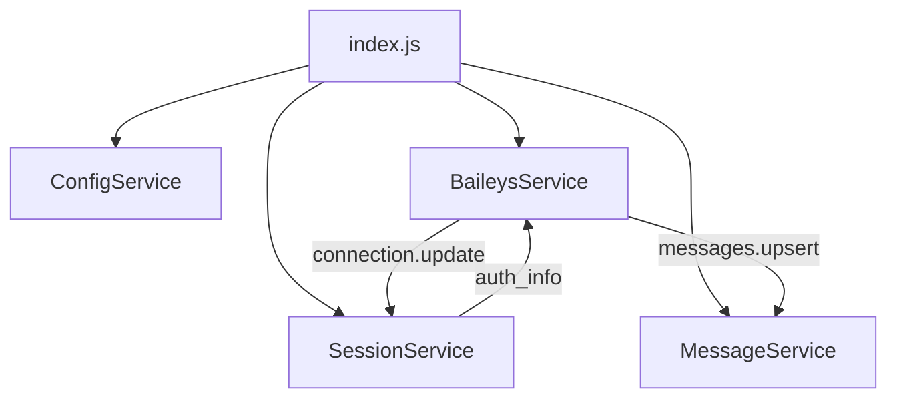
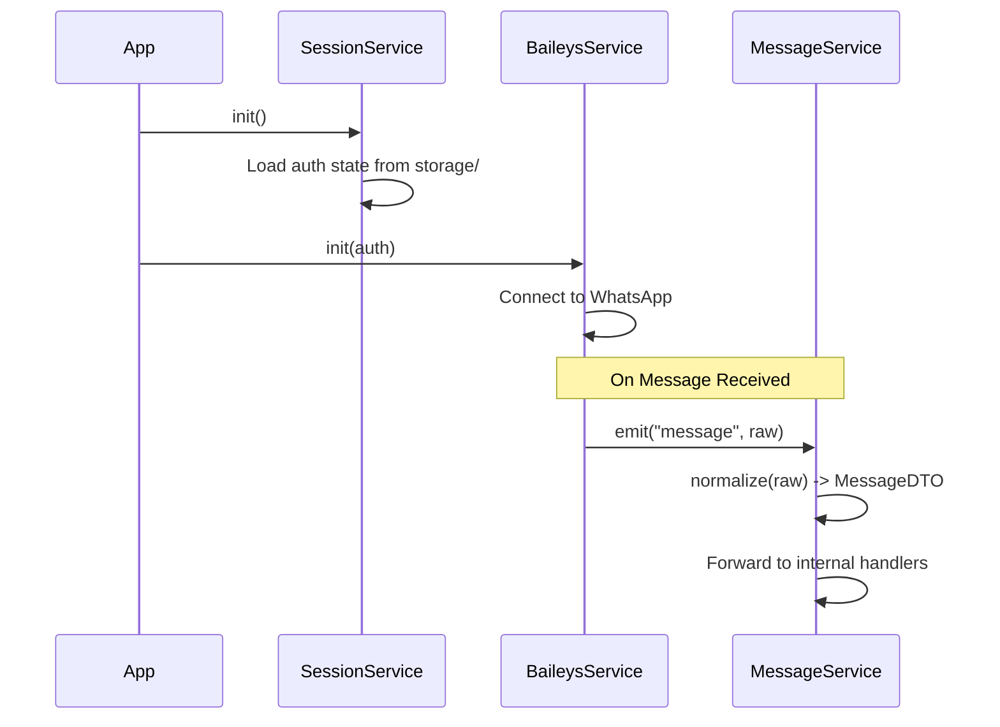

# Design: 001-foundation-refactoring

## 1. Overview
Esta fase se centra en la transición de una arquitectura monolítica basada en `index.js` y `WhatsAppClient.js` hacia una estructura de servicios desacoplados. Se implementarán tres servicios principales: `BaileysService`, `MessageService` y `SessionService`.

## 2. Arquitectura de Componentes
Se utiliza una arquitectura de servicios con comunicación basada en eventos para minimizar el acoplamiento.

## 3. Flujo de Datos
El flujo principal de inicialización y recepción de mensajes:

## 4. Interfaces y DTOs
### MessageDTO
Estructura de datos estandarizada para todos los mensajes entrantes:
- `id`: string (message key id)
- `remoteJid`: string (sender id)
- `pushName`: string (sender name)
- `messageType`: string (text, image, etc.)
- `content`: object/string (payload)
- `timestamp`: number

## 5. Estrategia de Sesión y Configuración
- **Almacenamiento**: Se utilizará el directorio `storage/` en lugar de `auth_info_baileys/` para una mejor organización.
- **Persistencia**: Uso de `useMultiFileAuthState` proporcionado por Baileys.
- **Configuración**: Centralizada en `src/config/` cargando variables de entorno.

## 6. Observabilidad y Logs
- **Librería**: `Pino` reemplazará a `console.log`.
- **Niveles**: `info`, `warn`, `error`, `debug`.
- **Formato**: JSON estructurado para facilitar la integración con sistemas de monitoreo en el futuro.
