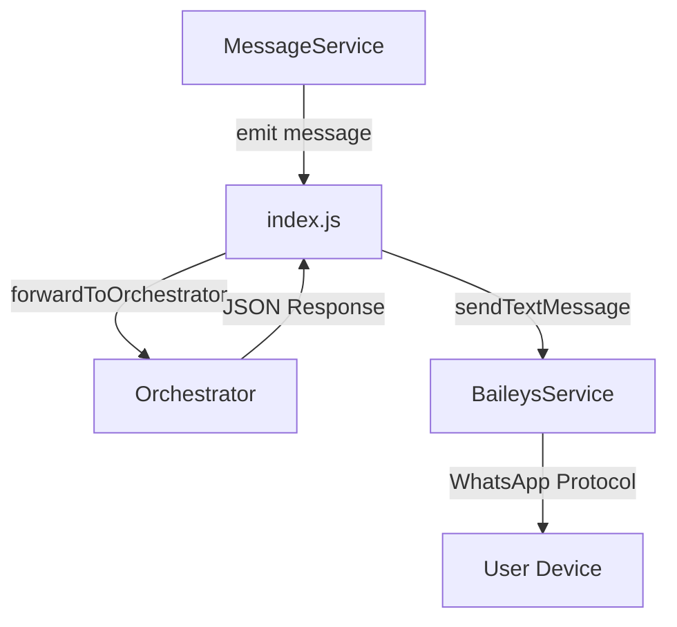
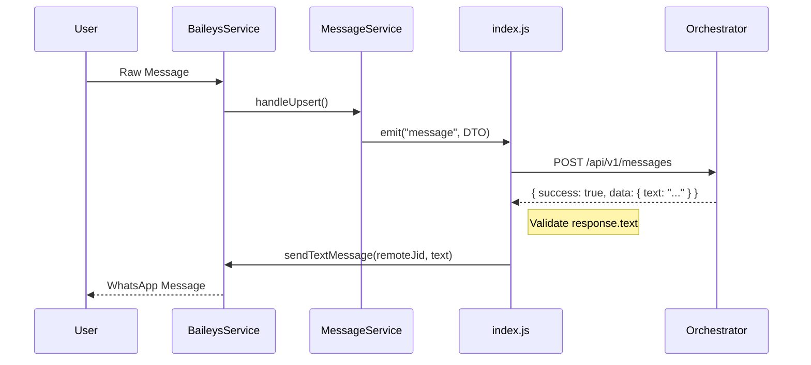

# Design: 002-1-reply-integration

## 1. Overview
Esta sub-fase (2.1) cierra el ciclo de comunicación (loop). El microservicio no solo actúa como gateway de entrada, sino que también gestiona la respuesta inmediata proveniente del orquestador de IA.

## 2. Arquitectura de Componentes
Se integra el flujo de salida directamente en el manejador de eventos del `index.js`, utilizando `BaileysService` para la entrega final.

## 3. Flujo de Datos
Secuencia completa de una interacción:

## 4. Interfaces y DTOs
No se requieren nuevos DTOs, se utiliza el campo `text` de la respuesta del orquestador:
- `response.data.text`: El contenido a enviar.

## 5. Estrategia de Respuesta
- **Validación**: Se ignora cualquier respuesta que no sea exitosa o cuyo texto sea nulo/vacío.
- **Manejo de Errores**: Log & Ignore. No se implementan reintentos de envío a WhatsApp en esta fase para evitar duplicidad de mensajes en caso de errores de red intermitentes.

## 6. Observabilidad y Logs
- Log de respuesta recibida de IA: `debug`.
- Log de inicio de envío a WhatsApp: `info`.
- Log de éxito/fallo de envío: `info`/`error`.
