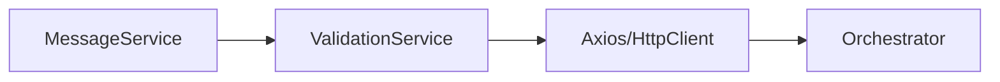
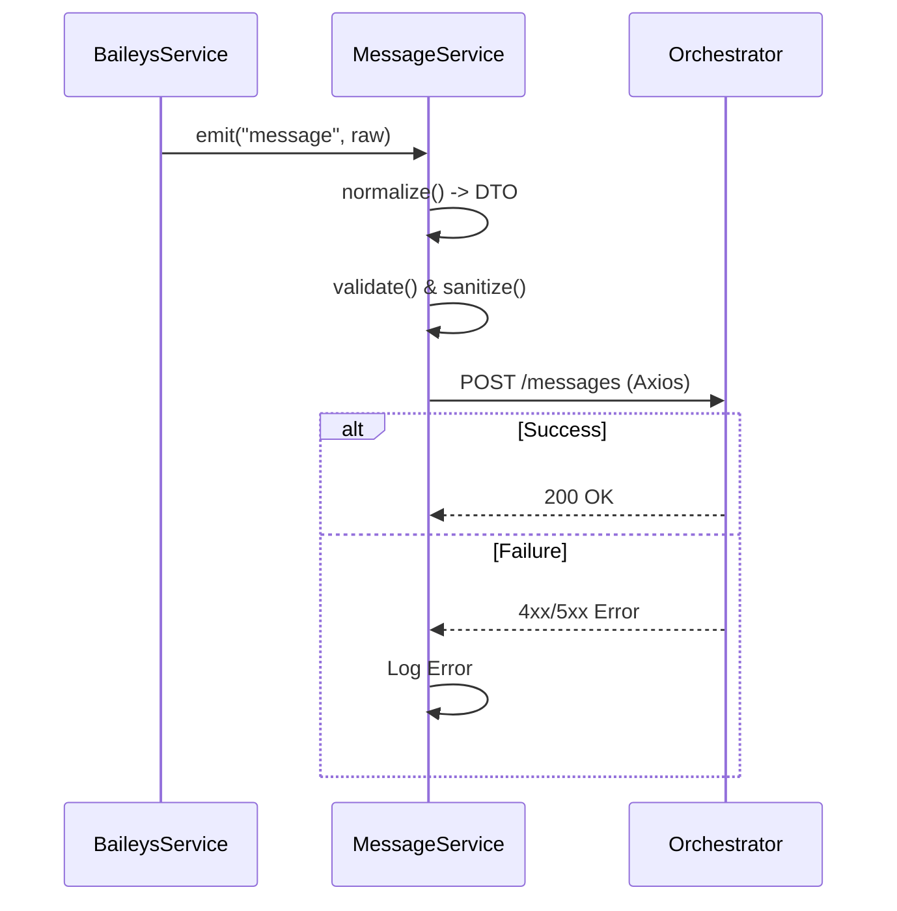

# Design: 002-message-normalization-forwarding

## 1. Overview
Esta fase implementa la integración saliente mediante HTTP REST. Se enfoca en la transformación final del mensaje y su entrega al orquestador central, priorizando la simplicidad y la validación de datos.

## 2. Arquitectura de Componentes
Se añade un nuevo servicio `HttpService` o se extiende `MessageService` para manejar la comunicación con `Axios`.



## 3. Flujo de Datos
Proceso de normalización y envío:



## 4. Interfaces y DTOs (Actualización)
### MessageDTO (Payload de Salida)
Para cumplir con el orquestador actual, el DTO se mapeará al siguiente esquema en el POST:
- `senderId`: string (Mapeado desde `remoteJid`)
- `text`: string (Mapeado desde `content`)
- `assistantName`: string (Fijo: "tec_praxis_InnovaBot" o configurable)
- `createdBy`: string (Fijo: "app-wps")

### Ejemplo de Request Funcional
```bash
curl --location 'http://127.0.0.1:8081/api/v1/messages' \
--header 'Content-Type: application/json' \
--data '{ 
    "senderId": "7252d48c45bb5a202ba6e8cd6b2c8639cf1d57bca", 
    "text": "hola bot", 
    "assistantName": "tec_praxis_InnovaBot", 
    "createdBy": "app-wps" 
}'
```

## 5. Estrategia de Envío
- **Cliente**: Axios.
- **Timeout**: 5000ms.
- **Modo**: Fire & Forget (No hay reintentos en esta fase según definición del usuario).

## 6. Observabilidad y Logs
- Logs de envío exitoso: `info` con `msgId` y latencia.
- Logs de error: `error` con status code y body de respuesta (si aplica).
