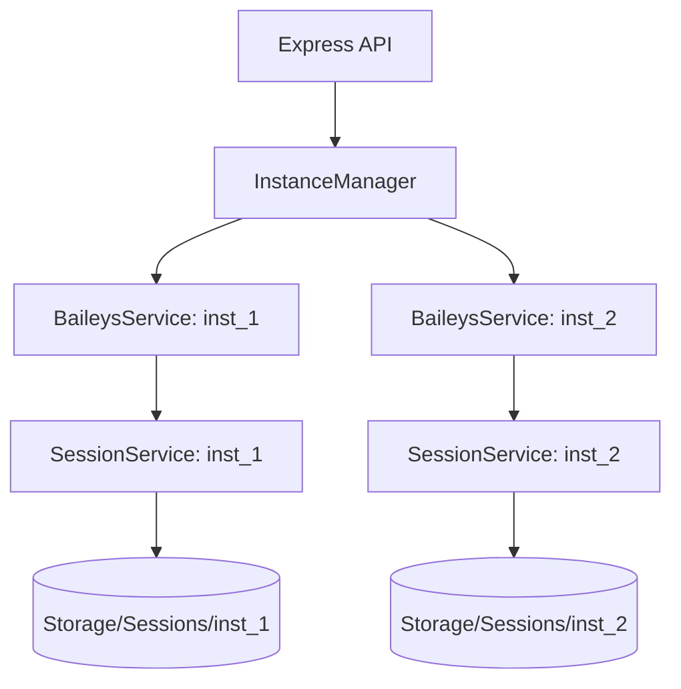
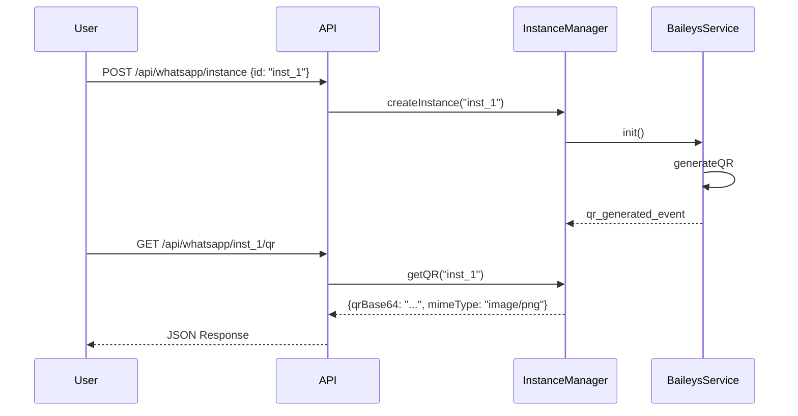

# Diseño: Gestión de Conexiones QR

## 1. Introducción
Este diseño detalla la transición del microservicio de una única sesión estática a un sistema capaz de gestionar múltiples instancias dinámicas de WhatsApp. Se enfoca en la exposición de una API REST para el control de sesiones y la recuperación de códigos QR.

## 2. Arquitectura de Componentes
El sistema evolucionará a un modelo de "Manager" que orquestará múltiples servicios de Baileys.



## 3. Detalles de Componentes
- **InstanceManager:** Singleton que mantiene el mapa de instancias activas. Maneja el ciclo de vida (crear, destruir, buscar).
- **BaileysService (Refactor):** Se instanciará por cada conexión. Mantendrá el estado del último QR generado y el contador de reintentos.
- **SessionService (Refactor):** Recibirá el `instanceId` en su constructor para determinar la ruta de almacenamiento de credenciales.

## 4. Flujo de Datos (Secuencia de Conexión QR)



## 5. Especificación de Interfaces
### POST /api/whatsapp/instance
- **Body:** `{ "instanceId": "string" }`
- **Success:** 201 Created
- **Error:** 409 Conflict (si ya existe)

### GET /api/whatsapp/:instanceId/qr
- **Success:** 200 OK
  ```json
  {
    "qrBase64": "iVBORw0KGgoAAAANSUhEUg...",
    "mimeType": "image/png"
  }
  ```
- **Error:** 404 Not Found (instancia no existe), 202 Accepted (instancia existe pero QR aún no generado).

## 6. Estrategia de Pruebas
- **Mocking de Baileys:** Utilizar mocks para los eventos de socket y evitar conexiones reales durante los tests unitarios.
- **Validación de Almacenamiento:** Verificar que tras la creación de una instancia, se cree la carpeta correspondiente en `storage/sessions/`.
- **Test de Límite de QR:** Simular 3 eventos de QR sin escaneo y verificar que la instancia invoque su método de cierre/destrucción.
