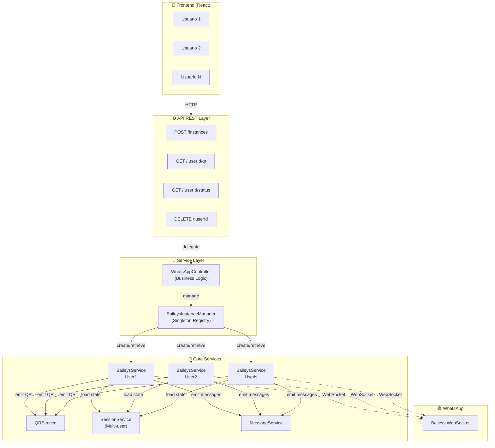
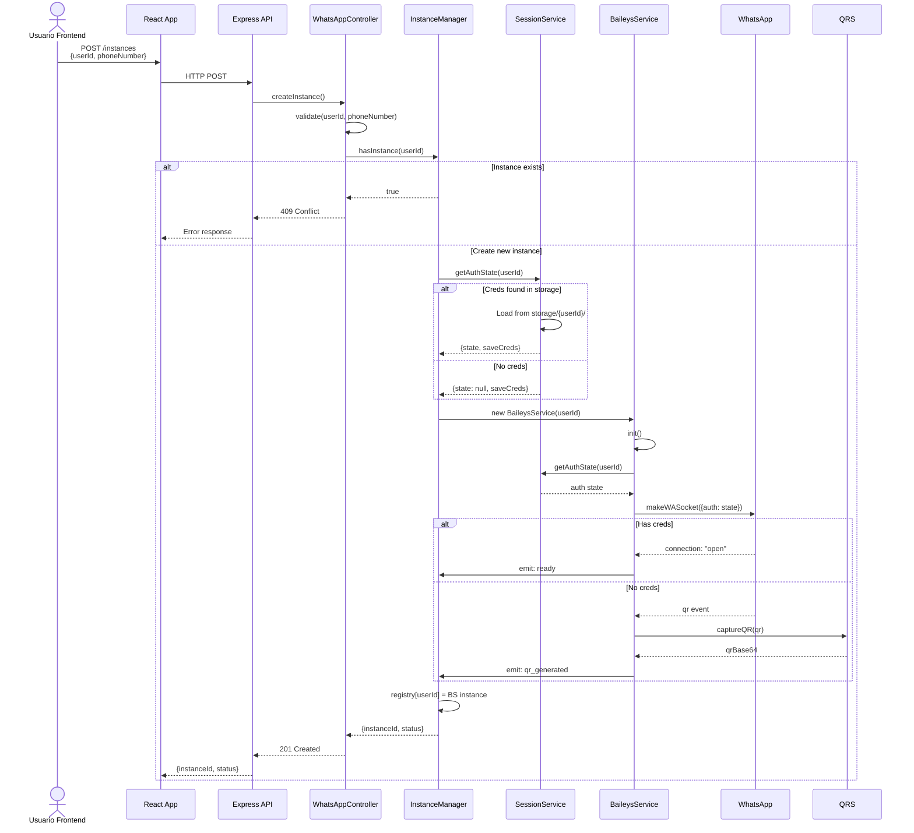
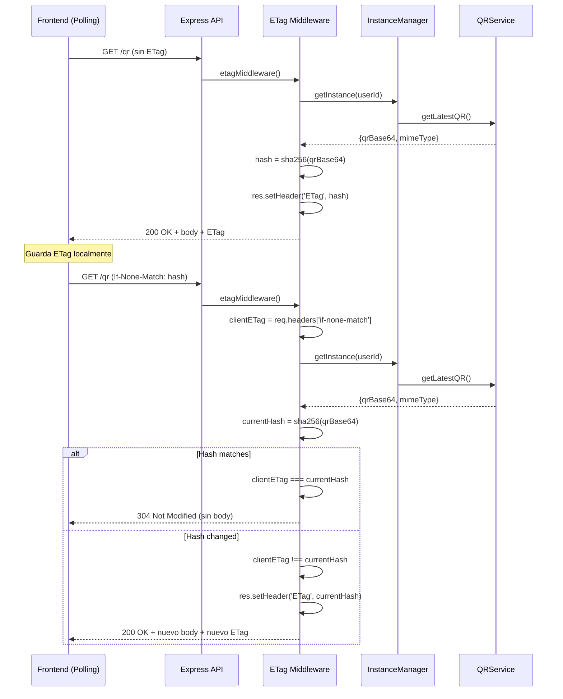
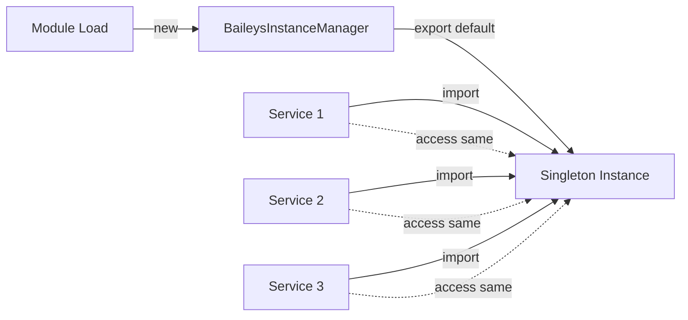
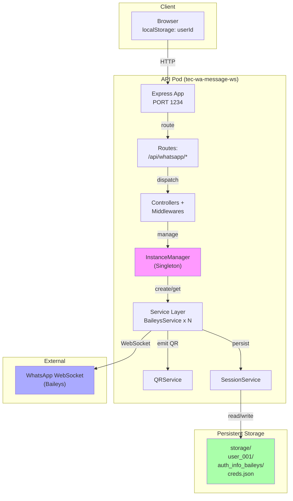

# Diseño Arquitectónico - Feature 003: QR Connection Management

**Última actualización:** 2024
**Estado:** En Revisión de Diseño
**Versión:** 1.0

---

## 1. PROBLEMA Y CONTEXTO

### El Reto
Actualmente, `tec-wa-message-ws` gestiona una **única instancia hardcodeada** de WhatsApp. Esto limita la plataforma a:
- ❌ Un solo número de WhatsApp por despliegue
- ❌ Un usuario Frontend por instancia
- ❌ QR visible solo en terminal (no accesible vía REST)
- ❌ Sin recuperación automática de sesión

### Alineación Misional
Esta feature implementa el objetivo de **Multi-Session Scalability** del proyecto:
> "Design with the capability to manage and persist multiple WhatsApp sessions/accounts."

### Restricciones Técnicas
- **Baileys v7+**: API event-driven, no persiste QR en memoria automáticamente
- **Express 5**: Stateless, debe delegarse gestión de estado a servicios
- **Pino**: Logging estructurado obligatorio
- **ES Modules**: Importaciones con extensión `.js` requerida

---

## 2. SOLUCIÓN PROPUESTA (HIGH-LEVEL)

### Arquitectura General



### Flujo de Datos: Creación de Instancia



### Flujo de Datos: Obtener QR con Caché ETag



---

## 3. COMPONENTES CLAVE

### 3.1 QRService
**Responsabilidad:** Capturar QR de Baileys y convertir a Base64

```mermaid
class QRService {
    -lastQR: {qrBase64, mimeType, timestamp}
    -qrCache: Map<string, QRData>
    -cacheTTL: number
    
    +captureQR(qrImage): void
    +getLatestQR(): QRData | null
    +generateHash(qrBase64): string
    +clearCache(): void
}
```

**Detalles:**
- Almacena QR en memoria con TTL de 5 minutos
- Genera hash SHA-256 para ETag
- Convierte imagen QR a Base64 automáticamente

---

### 3.2 BaileysInstanceManager
**Responsabilidad:** Registry centralizado de instancias BaileysService

```mermaid
class BaileysInstanceManager {
    -instances: Map<userId, BaileysService>
    -instanceMetadata: Map<userId, {createdAt, phoneNumber, status}>
    
    +createInstance(userId, phoneNumber): BaileysService
    +getInstance(userId): BaileysService | null
    +hasInstance(userId): boolean
    +getAllInstances(): Map<userId, BaileysService>
    +deleteInstance(userId): boolean
    +getStatus(userId): string
    +on(event, handler): void
}
```

**Detalles:**
- **Singleton Pattern**: Una única instancia en toda la app
- Acceso O(1) via Map
- Emite eventos: `instance:created`, `instance:ready`, `instance:disconnected`

---

### 3.3 SessionService Refactorizado
**Responsabilidad:** Persistencia multi-usuario de credenciales

```mermaid
class SessionService {
    -sessionPath: string
    
    +getAuthState(userId): Promise<{state, saveCreds}>
    +saveCreds(userId, creds): Promise<void>
    +clearSession(userId): Promise<void>
    +sessionExists(userId): Promise<boolean>
    
    -ensureUserDirectory(userId): Promise<void>
    -loadCredsFromDisk(userId): Promise<object>
    -writeCredsToDisk(userId, creds): Promise<void>
}
```

**Detalles:**
- Estructura: `storage/{userId}/auth_info_baileys/`
- Isolación por usuario: cero cross-contamination
- Métodos async para I/O de disco

---

### 3.4 BaileysService Adaptado
**Responsabilidad:** Gestión de socket WhatsApp con userId inyectado

```mermaid
class BaileysService {
    -userId: string
    -sock: WASocket
    -sessionService: SessionService
    -qrService: QRService
    
    +init(userId): Promise<WASocket>
    +sendTextMessage(to, text): Promise<void>
    +sendMessage(to, content): Promise<void>
    
    -setupConnectionHandlers(): void
    -setupQRHandler(): void
    -setupMessageHandler(): void
}
```

**Detalles:**
- Constructor recibe userId como parámetro
- Usa SessionService.getAuthState(userId)
- Emite QR a través de QRService
- Todos los métodos tienen contexto de userId

---

### 3.5 WhatsAppController
**Responsabilidad:** Lógica de negocio para endpoints

```mermaid
class WhatsAppController {
    +createInstance(userId, phoneNumber): Promise<{instanceId, status}>
    +getQR(userId): Promise<{qrBase64, mimeType}>
    +getStatus(userId): Promise<{status}>
    +deleteInstance(userId): Promise<boolean>
    
    -validatePhoneNumber(phone): boolean
    -validateUserId(userId): boolean
    -buildErrorResponse(code, message): object
}
```

**Detalles:**
- Orquesta llamadas entre InstanceManager, SessionService, BaileysService
- Maneja validación de inputs
- Construcción de responses estructuradas

---

### 3.6 Middlewares
**ETag Middleware:**
```javascript
// Entrada: GET /qr
// Salida: 304 si QR sin cambios, 200 si cambió
// Beneficio: 90% reducción ancho de banda
```

**Error Handler Middleware:**
```javascript
// Centraliza captura de excepciones
// Retorna JSON consistente
// Logs estructurados con Pino
```

---

## 4. PATRONES DE DISEÑO

### 4.1 Singleton (BaileysInstanceManager)
**Por qué:** Garantiza un único punto de acceso al registry de instancias



### 4.2 Factory Pattern (BaileysInstanceManager.createInstance)
**Por qué:** Encapsula lógica de creación de BaileysService

```javascript
// En lugar de:
const bs = new BaileysService(userId);
bs.init();
// Hacer:
const bs = manager.createInstance(userId, phoneNumber);
// Manager se encarga de validación, registro, inicialización
```

### 4.3 Repository Pattern (SessionService)
**Por qué:** Abstrae persistencia de credenciales

```javascript
// El resto de servicios no conocen `storage/{userId}/`
// SessionService es única responsable de persistencia
const {state, saveCreds} = await sessionService.getAuthState(userId);
```

### 4.4 Observer Pattern (EventEmitter)
**Por qué:** Desacoplamiento entre servicios

```javascript
// BaileysService emite eventos
baileysService.on('qr', (qrData) => qrService.capture(qrData));
baileysService.on('ready', () => controller.notifyFrontend());
baileysService.on('message', (msg) => messageService.handle(msg));
```

### 4.5 DTO Pattern (QRData, InstanceDTO)
**Por qué:** Consistencia en serialización

```javascript
// QRData DTO
{
  qrBase64: "iVBORw...",
  mimeType: "image/png",
  timestamp: 1234567890,
  expiresAt: 1234567890 + 300000
}

// InstanceDTO
{
  instanceId: "uuid",
  userId: "user_001",
  phoneNumber: "+34 666 123 456",
  status: "ready|waiting_scan|disconnected",
  createdAt: 1234567890
}
```

---

## 5. DECISIONES TÉCNICAS JUSTIFICADAS

| Decisión | Alternativa | Por qué fue elegida |
|----------|-------------|-------------------|
| **Polling + ETag (no WebSocket)** | WebSocket desde inicio | MVP rápido, suficiente latencia para QR, reduce complejidad inicial |
| **Map<userId, instance>** | Array o DB | O(1) lookup, en memoria, escalable para MVP |
| **Caché QR en memoria** | Desde Baileys siempre | Baileys no persiste QR, caché reduce I/O |
| **SessionService isolada por userId** | Session global | Multi-tenancy, cero cross-contamination, preparado para escala |
| **BaileysService con userId inyectado** | BaileysService singleton | Permite múltiples instancias independientes simultáneamente |
| **Pino + structured logs** | console.log | Production-ready, parseable, auditable |
| **HTTP 304 Not Modified** | Custom protocol | Estándar HTTP, browser caching automático, ancho de banda ~90% menor |

---

## 6. CONSIDERACIONES DE ESCALABILIDAD Y RIESGOS

### 6.1 Limitaciones Actuales
- ⚠️ Instancias en memoria: se pierden en reinicio (mitigado por persistencia de creds)
- ⚠️ Máximo recomendado: ~50 instancias por pod (1 conexión TCP = ~100KB)
- ⚠️ Caché QR: 5 minutos TTL, suficiente para MVP

### 6.2 Roadmap Futuro
- **Fase 4**: Redis para caché distribuido (soportar múltiples pods)
- **Fase 5**: Base de datos para metadata de instancias (auditoría)
- **Fase 6**: WebSocket para notificaciones real-time (status, mensajes)
- **Fase 7**: Circuit breaker para reconexión automática

### 6.3 Riesgos y Mitigaciones

| Riesgo | Probabilidad | Impacto | Mitigación |
|--------|------------|--------|-----------|
| Cross-contamination entre usuarios | Media | Alto | Tests E2E multi-usuario, isolación por userId |
| QR expires sin refrescarse | Baja | Medio | TTL + evento de expiración |
| Instancia no se libera en delete | Baja | Medio | Cleanup en DeleteInstance, event listeners removal |
| Caché inconsistente | Baja | Bajo | ETag hash validation, test de cache coherency |
| OOM con muchas instancias | Baja (MVP) | Alto | Monitoreo de memoria, alertas, documentación de límites |

---

## 7. DIAGRAMA DE DESPLIEGUE



---

## 8. ESPECIFICACIÓN DE ENDPOINTS

### 8.1 POST /api/whatsapp/instances
```
Request:
{
  userId: string (required, alphanumeric + underscore)
  phoneNumber: string (required, formato +XX XXXXXXXXX)
}

Response 201:
{
  instanceId: uuid,
  userId: string,
  status: "generating_qr",
  createdAt: ISO 8601
}

Response 409:
{
  error: "Usuario ya tiene una instancia activa",
  code: "INSTANCE_EXISTS"
}

Response 400:
{
  error: "Campo requerido",
  field: "phoneNumber"
}
```

### 8.2 GET /api/whatsapp/instances/:userId/qr
```
Request:
  If-None-Match: "abc123" (opcional)

Response 200:
{
  qrBase64: "iVBORw0KG...",
  mimeType: "image/png"
}
Header: ETag: "abc123"

Response 304:
  (sin body)
Header: ETag: "abc123"

Response 204:
  (sin body, QR aún no disponible)
```

### 8.3 GET /api/whatsapp/instances/:userId/status
```
Response 200:
{
  status: "waiting_scan" | "ready" | "disconnected",
  connectedAt?: ISO 8601,
  disconnectedAt?: ISO 8601
}

Response 404:
{
  error: "Instancia no encontrada",
  code: "INSTANCE_NOT_FOUND"
}
```

### 8.4 DELETE /api/whatsapp/instances/:userId
```
Response 204:
  (sin body)

Response 404:
{
  error: "Instancia no encontrada",
  code: "INSTANCE_NOT_FOUND"
}
```

---

## CONCLUSIÓN

Esta arquitectura proporciona:
✅ **Multi-tenancy** con aislamiento de usuario
✅ **Escalabilidad horizontal** (preparada para redis/db)
✅ **MVP rápido** sin complejidades prematuras
✅ **Coherencia misional** con objetivos de multi-session
✅ **Production-ready** con logging, error handling, tests
